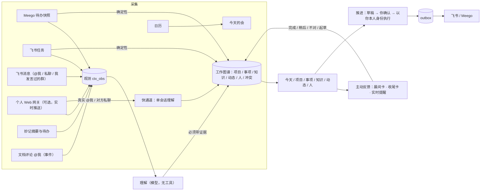

# 工作上下文（Working Context）

Avatar 的主线不是派单，而是**替你维护一份始终最新的工作上下文**：从飞书消息、Meego、妙记、日历、飞书任务和文档评论里识别你的**项目、事项、知识、动态和人**，主动告诉你今天该做什么，并帮你推进（起草回复 / 跟进 / Meego 评论 / 周报）。派单（把事交给 Agent 执行）退到「更多」里，是推进事项的一种方式。

## 1. 数据流



- **采集**（`src/context/connectors.ts`）：只读，按游标增量拉取，靠 ID 去重。分页接口逐页显式翻页，翻页不完整（缺 `page_token`、超出保护页数等）时报错且不推进游标；观测落库与游标推进在同一事务里提交。机器人消息只保留 `bot_allow` 里的（M0 数据里约 40% 是机器人噪音）。单个来源失败只记录错误，不影响其他来源。
- **个人 Web 实时通道**（可选，`src/context/personal-web.ts`）：从独立部署的 `feishu-gateway` 订阅实时消息，与上面的定时采集并存、互为兜底，见第 6 节。
- **确定性来源**：Meego 待办和飞书任务直接成为事项（强标识 `meego:<工作项>:<节点>`、`task:<guid>`）。拉到完整快照时，从快照里消失的节点自动关闭；拉不全时不做推断。长期没有动静的空间（默认 180 天）视为历史遗留，自动静音。
- **理解**（`src/context/understand.ts`）：按会话把新消息和最近的背景交给模型，输出项目 / 事项 / 知识 / 动态 / 人 / 冲突的结构化更新。
  - 每条结论必须引用这批消息里真实存在的观测 ID，否则丢弃（防幻觉）。
  - 已有事项用 `ref` 更新或关闭（跨来源闭环：你在群里回复了，对方的请求就关掉）。
  - 置信度低于 `min_confidence` 的事项标为「待确认」，不进今天的焦点。
  - 你的纠正（「不对」「不重要」）作为校准样例进入下一次理解的提示词。
  - 消息内容一律当作不可信数据：模型没有任何工具，提示词里明确不执行消息里的指令。
- **项目两层**：上级项目是产品或大项目，子项目是其中一条有独立目标、相关人和节奏的工作线（功能、对接、专项、版本、事故）。理解时事项 / 知识 / 动态 / 冲突归到最具体的子项目；上级项目的页面汇总所有子项目的内容；静音上级时子项目一起隐藏。已有的大项目可以在项目页点「拆分子项目」（或 `pa context split <项目>`），由模型按工作线归类后移动，只认这个项目里已有的 ID，少于两条内容的子项目不建。
- **不重要的类型**（`context.not_important`，标题正则）：如文档阅读申请、权限申请、审批待办。匹配的事项自动降为「不重要」（仍保留、排在最后、不发实时提醒），同时告诉模型按低优先级输出。
- **冲突去重**：同一项目里话题高度重合（换了环境名或措辞）或引用同一条消息的冲突合并成一条；提示词里列出未解决的冲突，同一问题的新说法用 ref 追加。每轮周期也会合并历史上已经重复的冲突。
- **排序**（`src/context/views.ts`）：规则打分且可解释，每件事都带「为什么排在这里」（别人在等你、你答应过、已逾期、今天到期、已过 N 天、等了超过 2 天……）。

## 2. 界面

| 界面 | 内容 |
|---|---|
| 控制台「今天」 | 先做这几件（排序 + 原因 + 完成 / 稍后 / 起草 / 不对）、需要你判断的冲突、待确认的草稿、按类型看（别人在等你 / 你答应过 / 你在等别人 / 风险 / 待确认识别）、今天的会、过去 24 小时的动态、项目健康、数据来源状态 |
| 项目 / 项目详情 | 阶段、我的角色、健康度、进行中与已完成的事项、知识、动态、相关的人、冲突；可静音 |
| 事项 / 事项详情 | 按状态与类型筛选、搜索；详情里是原始消息证据链、草稿、操作（含「交给 Agent」） |
| 知识 / 动态 / 人 / 草稿 | 决策与结论（带依据）、按天的项目动态、合作的人、草稿的编辑与发送 |
| 飞书卡片 | 晨间卡 `ctx-morning:<日期>`、收尾卡 `ctx-evening:<日期>`、实时提醒 `ctx-item:<事项>`、草稿 `ctx-draft:<草稿>`；按钮操作后原地刷新 |

## 3. 自主等级

| 等级 | 做什么 | 开关 |
|---|---|---|
| L0 提醒 | 晨间卡、收尾卡、实时提醒（新出现的高优先级请求 / 风险、两天内到期的承诺；每轮最多 3 条，只提醒最近 6 小时出现的） | `context.nudge`、`notify.types.nudge` |
| L1 起草 | 回复、跟进、Meego 评论、周报。**草稿只是建议**，确认前可编辑；确认后才进入 outbox，以你本人身份执行 | 永远需要确认 |
| L2 自己的低风险动作 | 有证据时自动关闭事项、自动静音历史遗留、把你的承诺建成你自己的飞书任务 | `context.autonomy.*` |
| L3 委托 | 把事项交给 Agent 执行（新建派单，描述里附上下文与原文链接） | 你手动点「交给 Agent」 |

对外可见的动作（发消息、写 Meego 评论、建文档）只会在你确认草稿后发生。确认用比较并交换（`proposed|failed → approved`），卡片和控制台同时点只生效一次；草稿状态由 outbox 推导（成功 → 已发送，重试耗尽 → 发送失败，可修改后重新发送），进程中途退出也不会卡在「发送中」。

## 4. 存储

全部在本地 SQLite（`data_dir/state.db`）里，`ctx_` 前缀：

| 表 | 内容 |
|---|---|
| `ctx_obs` | 观测（消息、Meego 待办、任务、妙记、文档评论），`processed` 标记是否已理解 |
| `ctx_project` | 项目：名称、别名、引用（如 `meego:123`）、阶段、角色、健康度、状态（active / legacy / archived）、静音、`pinned`（你手动改过，模型不再覆盖） |
| `ctx_item` | 事项：类型（todo / ask_me / my_commitment / waiting_on / meeting_action / risk）、状态、优先级、截止、对方、下一步、强标识、置信度、`user_locked`（你手动完成 / 驳回后模型不能改回） |
| `ctx_evidence` | 事项 / 知识 / 动态与观测的引用关系（证据链） |
| `ctx_knowledge` / `ctx_update` / `ctx_person` / `ctx_conflict` | 知识、动态、人、冲突 |
| `ctx_feedback` | 你的反馈（right / wrong / unimportant），用于校准 |
| `ctx_draft` | 草稿与发送状态 |
| `ctx_mute_conv` | 不再读取的会话 |
| `ctx_pw_alias` | 个人 Web 原生 ID 与开放平台 / 名称的对应，来自跨通道匹配：`chat`（原生会话 → `oc_`）、`chat_name`（原生会话 → 真实会话名）、`actor`（原生用户 → 姓名）、`msg`（原生消息 → 合并后的观测 ID，撤回时用来联动删除） |

个人 Web 通道的游标与绑定存在 kv 表：`ctx.pw_gateway.cursor`（已处理到的网关事件 seq）、`ctx.pw_gateway.db_epoch`（网关事件库实例标识）、`ctx.personal_web.bound_owner_id`（工作区绑定的个人账号）。网关自己的事件缓存、会话名缓存和发送幂等账本在网关数据目录的 `gateway.db` 里，Avatar 不直接读写。

账本里 `kind = "context"` 的工作：采集理解周期 `context:cycle:<时间槽>`、快通道 `context:fast:<会话>:<触发观测>`、起草 `context:draft:*`、拆分子项目 `context:split:*`、周报 `context:weekly:*`。和其他工作一样有租约、重试和崩溃恢复。

## 5. 使用

```bash
bin/pa context run       # 立即采集并理解一轮，打印各来源结果
bin/pa context today     # 在终端看「今天」
bin/pa context digest morning   # 发晨间卡（--print 只打印）
bin/pa context split 方舟 Managed Agents   # 把大项目拆成子项目
bin/pa context web-status --verify   # 可选：个人 Web 网关的连接与缓存状态（部署见第 6 节）
bin/pa run               # 常驻：每 10 分钟采集，8:30 晨间卡，18:30 收尾卡，周五 17:00 周报草稿
```

理解用的模型由 `context.harness` 决定（缺省 `roles.brain`）。没有安装 acpx 时，可以直接用 Codex CLI：

```yaml
harnesses:
  codex-ro: { type: codex-exec, cmd: codex }
context:
  harness: codex-ro
```

> [!WARNING]
> 开启 `context.understand` 后，采集到的飞书消息、妙记、文档评论内容会发送给对应的模型服务。只想用确定性部分（Meego、飞书任务、日历）时把它设为 `false`。
>
> 个人 Web 实时通道（`context.personal_web.enabled`，默认关闭）基于飞书网页会话与私有长连接协议，可能随上游变更失效；会话 Cookie 只存放在独立网关的数据目录里，经 AES-256-GCM 加密（密钥来自网关侧的 `FEISHU_GW_KEY` 或 systemd `CREDENTIALS_DIRECTORY/feishu-gw-key`），开启前请确认符合你的账号与数据使用规范。

## 6. 个人 Web 实时通道（可选）

定时采集每 10 分钟一轮，且只覆盖 @我、私聊和我发言过的群。个人 Web 实时通道以你本人的飞书网页会话接收推送，任意群里真实 @我、对方私聊几秒内就能触发理解和提醒。

### 6.1 结构

```
飞书 ──WSS 长连接──▶ feishu-gateway（独立进程 / OS 用户 / 容器）
                      · 加密会话 Cookie、gateway.db（事件缓存 + 发送幂等账本）
                      · 先落库再 ACK；deny_chats 在这里强制生效
                      │ Unix Socket（0660）或回环 HTTP + SSE；read_token / reply_token 读写分离
                      ▼
Avatar（PersonalWebBridge）──▶ ctx_obs ──▶ 快通道 / 定时理解 ──▶ 草稿 ──你确认──▶ pw.reply ──▶ 网关
```

- 网关（`src/gateway/`，入口 `bin/feishu-gateway`）独占个人 Web 协议、会话 Cookie 和长连接，不依赖 Avatar 的任何业务模块。它对外只提供几个接口：只读的 `/v1/health`、`/v1/status`、`/v1/events`、`/v1/stream`（SSE）、`/v1/context`（补读某条消息之前的有界历史）用 `read_token`；`/v1/replies` 用 `reply_token`，两个令牌不能混用。
- Avatar 只是网关客户端：不接触 Cookie 和加密密钥，按持久化游标逐条消费事件，每条处理成功后才推进游标。

### 6.2 部署

1. **网关**：生产环境按 [deploy/feishu-gateway.service](../deploy/feishu-gateway.service) 的步骤以独立 OS 用户部署（或用 [deploy/Dockerfile.gateway](../deploy/Dockerfile.gateway)）。本机单用户调试可以这样：

   ```bash
   cp gateway.example.yaml gateway.yaml          # 按需改 deny_chats / allow_reply
   export FEISHU_GW_KEY="$(openssl rand -hex 32)"  # 妥善保存：重启后要用同一密钥解密会话
   bin/feishu-gateway login                      # 终端扫码，本人飞书 App 确认
   bin/feishu-gateway run                        # 常驻可用 deploy/feishu-gateway-forever.sh
   bin/feishu-gateway tokens                     # 打印 read_token / reply_token（文件模式）
   ```

   同一 OS 用户运行时，Avatar 的 worker 能读到网关数据目录和密钥，只适合调试。
2. **令牌**：文件模式用 `feishu-gateway tokens` 查看；systemd 模式下令牌就是 `/etc/feishu-gateway/secrets/read-token`、`reply-token`。Avatar 从 `context.personal_web.read_token_env` / `reply_token_env` 指定的环境变量（默认 `FEISHU_GW_READ_TOKEN` / `FEISHU_GW_REPLY_TOKEN`）读取，也接受 systemd `LoadCredential` 提供的 `feishu-gw-read-token` / `feishu-gw-reply-token`（或 `read-token` / `reply-token`）。只读使用时不要给 Avatar `reply_token`。
3. **Avatar**：在 `config.yaml` 里设置 `context.personal_web.enabled: true` 和 `gateway_socket`（如 `/run/feishu-gateway/gateway.sock`，本机调试为 `~/.feishu-gateway/run/gateway.sock`）或回环 `gateway_url`，导出只读令牌后重启 `pa run`。跨用户部署时运行 Avatar 的用户必须在 `feishu-gw-client` 组里；加组后要重新登录或重启该用户的 systemd 用户实例，新组才会生效，否则连接 socket 会报 `EACCES`。
4. **检查**：`pa context web-status --verify` 查看网关账号、状态、缓存与本地游标；`pa doctor` 会检查地址、令牌、登录状态，以及令牌隔离边界。

网关地址和令牌环境变量名只能手工改 `config.yaml`（控制台不允许修改），改后需要重启常驻进程。`fast_lane`、`debounce_ms`、`pre_draft`、`send_replies` 可以在控制台设置里热生效。

### 6.3 消息怎么进来

- **过滤**：网关先按 `gateway.yaml` 的 `deny_chats` 丢弃（命中的消息不落库、不下发、不允许回复）；Avatar 再按 `bot_allow`、`groups_deny`、静音会话、`groups`（`spoken` / `allowlist`；真实 @我 与私聊始终在范围内）过滤，然后写入 `ctx_obs`（ID `pw:<原生消息 ID>`，会话 `pw_chat:<原生会话 ID>`）。
- **快通道**：真实 @我 或对方私聊，按会话防抖 `debounce_ms` 后入队 `context:fast:*`，不等 10 分钟周期，只理解这一个会话并立刻推送提醒。若该会话最近 24 小时的观测不足 5 条，先经 `/v1/context` 补读最多 15 条历史作为背景（标为已处理）。`pre_draft: true` 时，对高优先级的「别人在等你」自动起草回复草稿，仍需你确认才发。同一会话不会被快通道和定时周期同时理解。
- **跨通道合并**：同一条消息先后从定时采集（`im:*`）和个人 Web（`pw:*`）进来时，同一说话人、同一会话类型、15 秒内且正文规范化后一致，就合并成一条观测，并回填开放平台消息 ID、会话 ID、群名、姓名，记进 `ctx_pw_alias`。会话名未知时只做弱匹配：丢弃重复，不回填任何 ID。
- **撤回 / 编辑清空**：网关下发 delete 墓碑后，Avatar 删除该原生消息对应的所有本地观测，包括合并进 `im:*` 的那一条。
- **账号绑定**：工作区第一次连上网关时绑定网关当前账号；之后网关账号不一致就停止消费并提醒你。确需换号：先在网关侧执行 `feishu-gateway login --force-switch-account`（清空旧账号的事件缓存、会话缓存与投递账本，并轮换 `db_epoch`），再在 Avatar 侧执行 `pa context web-unbind`（清空绑定、游标、别名缓存，历史观测保留）。
- **断线与重建**：网关连不上时 Avatar 退避重连；网关登录失效、令牌缺失或鉴权失败、账号不一致时每天提醒一次。期间定时采集照常兜底。断线恢复或网关缓存已滚动淘汰（gap）时补跑一轮常规采集补齐；网关事件库被重建（`db_epoch` 变化、本地游标超过网关最新 seq）时，还会把游标重置为 0、从新库重新消费。

### 6.4 经个人 Web 发送回复

默认关闭，需要同时满足：Avatar `context.personal_web.send_replies: true`、Avatar 持有 `reply_token`、网关 `allow_reply: true`。

- 只有消息还没拿到开放平台消息 ID（尚未被定时采集合并）时，草稿才走个人 Web；已合并的照常经 lark-cli 以你本人身份回复。个人 Web 只能**引用某条原消息回复**，没有单独「发到会话」：跟进草稿也是回复该事项最近一条对方发的证据消息（没有就用最近一条），标签写作「跟进回复 …（引用原消息 · 个人 Web）」。
- 确认草稿后产生 `pw.reply` 写操作。幂等键 `cid` 由草稿 ID 和正文哈希决定：同一草稿重复确认不会重复发送，改了正文才算新回复。
- 发送前，Avatar 先核对本地排除 / 静音规则，网关再核对 `allow_reply`、绑定账号、`deny_chats` 和 Avatar 传来的排除规则（用实时会话名），并实时回读原消息确认仍然存在。发出后独立回读，核验发送人、会话、父消息、cid 和正文。
- 网关记录每次发送的 sending / created / verified 状态：已发出但没来得及回读的，重试时只做回读核验；状态停在 sending、无法确认对方是否收到的，停止自动重试，提示你去飞书核实。确定性失败直接落终态，不消耗重试次数。

### 6.5 边界

- **私聊排除**：个人 Web 的会话元信息接口对单聊不返回对方姓名。网关 `deny_chats` 排除私聊只能写原生数字 `chat_id` 或 `pw_chat:<id>`；按联系人姓名排除 / 静音私聊，要等 Avatar 跨通道学到对方姓名后才生效。
- **令牌隔离**：和 Avatar 同一 OS 用户的 worker 能从 `/proc/<pid>/environ` 或 `$CREDENTIALS_DIRECTORY` 读到网关令牌：拿到 `read_token` 能读任意会话历史，网关开了 `allow_reply` 时拿到 `reply_token` 能以你本人身份发消息。需要真正隔离时，让派单 worker 以独立 OS 用户或容器运行；不需要发送时不要给 Avatar `reply_token`（`pa doctor` 会提示）。
- **从旧版升级**：旧版进程内的 `pa context web-login` 已移除。升级前先部署网关并配置 `gateway_socket` / `gateway_url`，否则 `personal_web.enabled: true` 会让配置校验失败；再用 `pa context web-logout` 删除 `<data_dir>/feishu-web.json` 残留，并从 Avatar 环境移除 `PA_FEISHU_WEB_KEY`。

## 7. 与原有功能的关系

- 启用工作上下文后，晨报 / 晚报由晨间卡 / 收尾卡代替；候选任务识别（`schedules.capture`）不再运行，文档评论和妙记事件交给工作上下文理解。
- 派单、交付、作业、健康、花费、设置都保留，在控制台「更多」里。事项可以一键「交给 Agent」变成派单。
- 关闭 `context.enabled` 即回到原来的派单平台形态。
