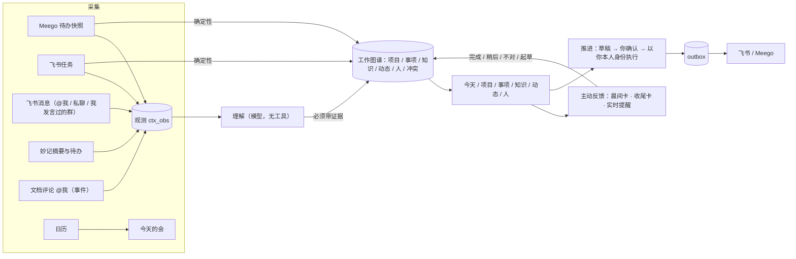

# 工作上下文（Working Context）

Avatar 的主线不是派单，而是**替你维护一份始终最新的工作上下文**：从飞书消息、Meego、妙记、日历、飞书任务和文档评论里识别你的**项目、事项、知识、动态和人**，主动告诉你今天该做什么，并帮你推进（起草回复 / 跟进 / Meego 评论 / 周报）。派单（把事交给 Agent 执行）退到「更多」里，是推进事项的一种方式。

## 1. 数据流



- **采集**（`src/context/connectors.ts`）：只读，按游标增量拉取，靠 ID 去重。机器人消息只保留 `bot_allow` 里的（M0 数据里约 40% 是机器人噪音）。单个来源失败只记录错误，不影响其他来源。
- **确定性来源**：Meego 待办和飞书任务直接成为事项（强标识 `meego:<工作项>:<节点>`、`task:<guid>`）。拉到完整快照时，从快照里消失的节点自动关闭；拉不全时不做推断。长期没有动静的空间（默认 180 天）视为历史遗留，自动静音。
- **理解**（`src/context/understand.ts`）：按会话把新消息和最近的背景交给模型，输出项目 / 事项 / 知识 / 动态 / 人 / 冲突的结构化更新。
  - 每条结论必须引用这批消息里真实存在的观测 ID，否则丢弃（防幻觉）。
  - 已有事项用 `ref` 更新或关闭（跨来源闭环：你在群里回复了，对方的请求就关掉）。
  - 置信度低于 `min_confidence` 的事项标为「待确认」，不进今天的焦点。
  - 你的纠正（「不对」「不重要」）作为校准样例进入下一次理解的提示词。
  - 消息内容一律当作不可信数据：模型没有任何工具，提示词里明确不执行消息里的指令。
- **项目两层**：上级项目是产品或大项目，子项目是其中一条有独立目标、相关人和节奏的工作线（功能、对接、专项、版本、事故）。理解时事项 / 知识 / 动态 / 冲突归到最具体的子项目；上级项目的页面汇总所有子项目的内容；静音上级时子项目一起隐藏。已有的大项目可以在项目页点「拆分子项目」（或 `pa context split <项目>`），由模型按工作线归类后移动，只认这个项目里已有的 ID，少于两条内容的子项目不建。
- **不重要的类型**（`context.not_important`，标题正则）：如文档阅读申请、权限申请、审批待办。匹配的事项自动降为「不重要」（仍保留、排在最后、不发实时提醒），同时告诉模型按低优先级输出。
- **冲突去重**：同一项目里话题高度重合（换了环境名或措辞）或引用同一条消息的冲突合并成一条；提示词里列出未解决的冲突，同一问题的新说法用 ref 追加。每轮周期也会合并历史上已经重复的冲突。
- **排序**（`src/context/views.ts`）：规则打分且可解释，每件事都带「为什么排在这里」（别人在等你、你答应过、已逾期、今天到期、已过 N 天、等了超过 2 天……）。

## 2. 界面

| 界面 | 内容 |
|---|---|
| 控制台「今天」 | 先做这几件（排序 + 原因 + 完成 / 稍后 / 起草 / 不对）、需要你判断的冲突、待确认的草稿、按类型看（别人在等你 / 你答应过 / 你在等别人 / 风险 / 待确认识别）、今天的会、过去 24 小时的动态、项目健康、数据来源状态 |
| 项目 / 项目详情 | 阶段、我的角色、健康度、进行中与已完成的事项、知识、动态、相关的人、冲突；可静音 |
| 事项 / 事项详情 | 按状态与类型筛选、搜索；详情里是原始消息证据链、草稿、操作（含「交给 Agent」） |
| 知识 / 动态 / 人 / 草稿 | 决策与结论（带依据）、按天的项目动态、合作的人、草稿的编辑与发送 |
| 飞书卡片 | 晨间卡 `ctx-morning:<日期>`、收尾卡 `ctx-evening:<日期>`、实时提醒 `ctx-item:<事项>`、草稿 `ctx-draft:<草稿>`；按钮操作后原地刷新 |

## 3. 自主等级

| 等级 | 做什么 | 开关 |
|---|---|---|
| L0 提醒 | 晨间卡、收尾卡、实时提醒（新出现的高优先级请求 / 风险、两天内到期的承诺；每轮最多 3 条，只提醒最近 6 小时出现的） | `context.nudge`、`notify.types.nudge` |
| L1 起草 | 回复、跟进、Meego 评论、周报。**草稿只是建议**，确认前可编辑；确认后才进入 outbox，以你本人身份执行 | 永远需要确认 |
| L2 自己的低风险动作 | 有证据时自动关闭事项、自动静音历史遗留、把你的承诺建成你自己的飞书任务 | `context.autonomy.*` |
| L3 委托 | 把事项交给 Agent 执行（新建派单，描述里附上下文与原文链接） | 你手动点「交给 Agent」 |

对外可见的动作（发消息、写 Meego 评论、建文档）只会在你确认草稿后发生。确认用比较并交换（`proposed|failed → approved`），卡片和控制台同时点只生效一次；草稿状态由 outbox 推导（成功 → 已发送，重试耗尽 → 发送失败，可修改后重新发送），进程中途退出也不会卡在「发送中」。

## 4. 存储

全部在本地 SQLite（`data_dir/state.db`）里，`ctx_` 前缀：

| 表 | 内容 |
|---|---|
| `ctx_obs` | 观测（消息、Meego 待办、任务、妙记、文档评论），`processed` 标记是否已理解 |
| `ctx_project` | 项目：名称、别名、引用（如 `meego:123`）、阶段、角色、健康度、状态（active / legacy / archived）、静音、`pinned`（你手动改过，模型不再覆盖） |
| `ctx_item` | 事项：类型（todo / ask_me / my_commitment / waiting_on / meeting_action / risk）、状态、优先级、截止、对方、下一步、强标识、置信度、`user_locked`（你手动完成 / 驳回后模型不能改回） |
| `ctx_evidence` | 事项 / 知识 / 动态与观测的引用关系（证据链） |
| `ctx_knowledge` / `ctx_update` / `ctx_person` / `ctx_conflict` | 知识、动态、人、冲突 |
| `ctx_feedback` | 你的反馈（right / wrong / unimportant），用于校准 |
| `ctx_draft` | 草稿与发送状态 |
| `ctx_mute_conv` | 不再读取的会话 |

账本里 `kind = "context"` 的工作：采集理解周期 `context:cycle:<时间槽>`、起草 `context:draft:*`、周报 `context:weekly:*`。和其他工作一样有租约、重试和崩溃恢复。

## 5. 使用

```bash
bin/pa context run       # 立即采集并理解一轮，打印各来源结果
bin/pa context today     # 在终端看「今天」
bin/pa context digest morning   # 发晨间卡（--print 只打印）
bin/pa context split 方舟 Managed Agents   # 把大项目拆成子项目
bin/pa run               # 常驻：每 10 分钟采集，8:30 晨间卡，18:30 收尾卡，周五 17:00 周报草稿
```

理解用的模型由 `context.harness` 决定（缺省 `roles.brain`）。没有安装 acpx 时，可以直接用 Codex CLI：

```yaml
harnesses:
  codex-ro: { type: codex-exec, cmd: codex }
context:
  harness: codex-ro
```

> [!WARNING]
> 开启 `context.understand` 后，采集到的飞书消息、妙记、文档评论内容会发送给对应的模型服务。只想用确定性部分（Meego、飞书任务、日历）时把它设为 `false`。

## 6. 与原有功能的关系

- 启用工作上下文后，晨报 / 晚报由晨间卡 / 收尾卡代替；候选任务识别（`schedules.capture`）不再运行，文档评论和妙记事件交给工作上下文理解。
- 派单、交付、作业、健康、花费、设置都保留，在控制台「更多」里。事项可以一键「交给 Agent」变成派单。
- 关闭 `context.enabled` 即回到原来的派单平台形态。
